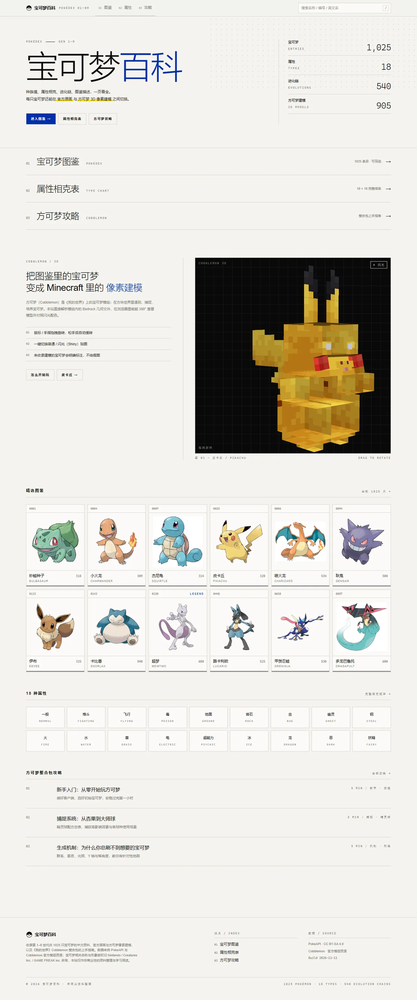
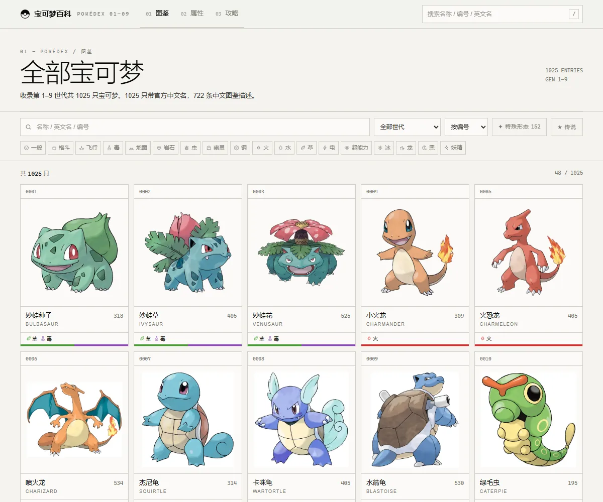
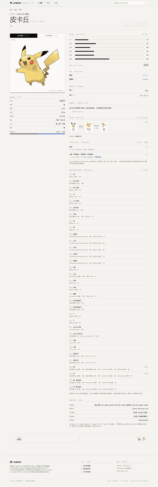
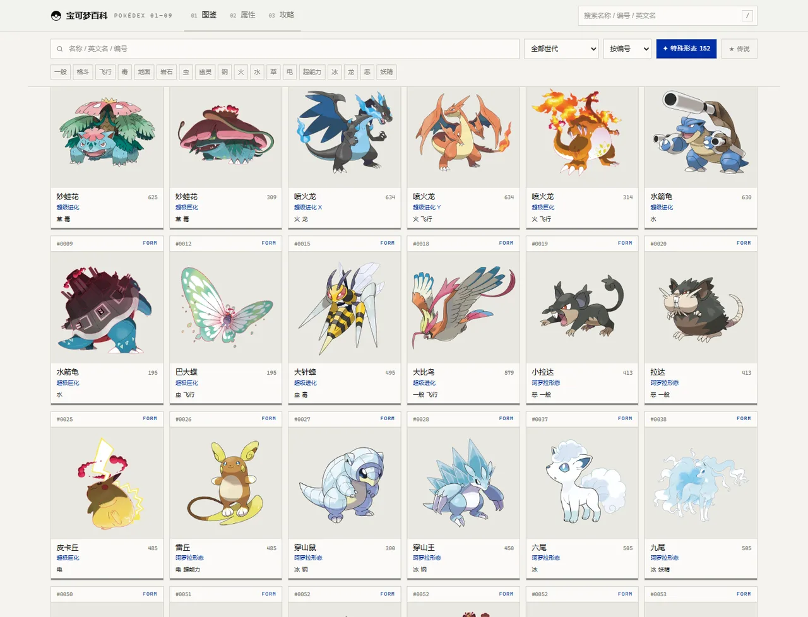
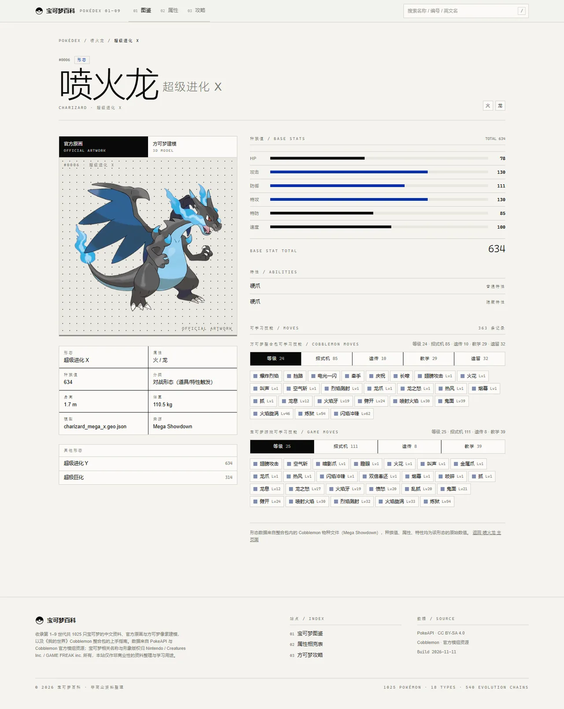
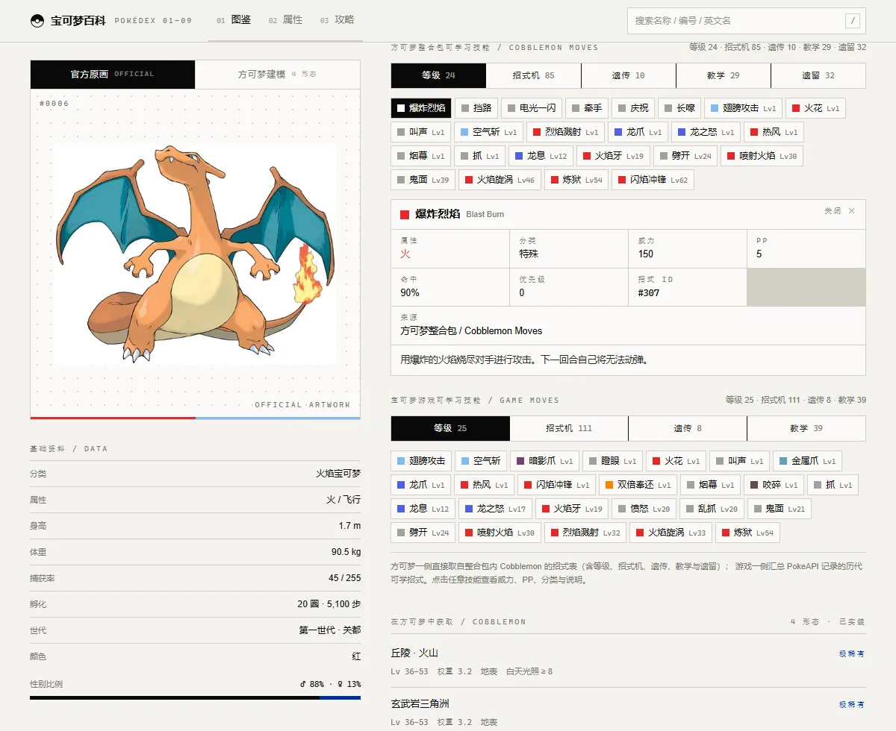
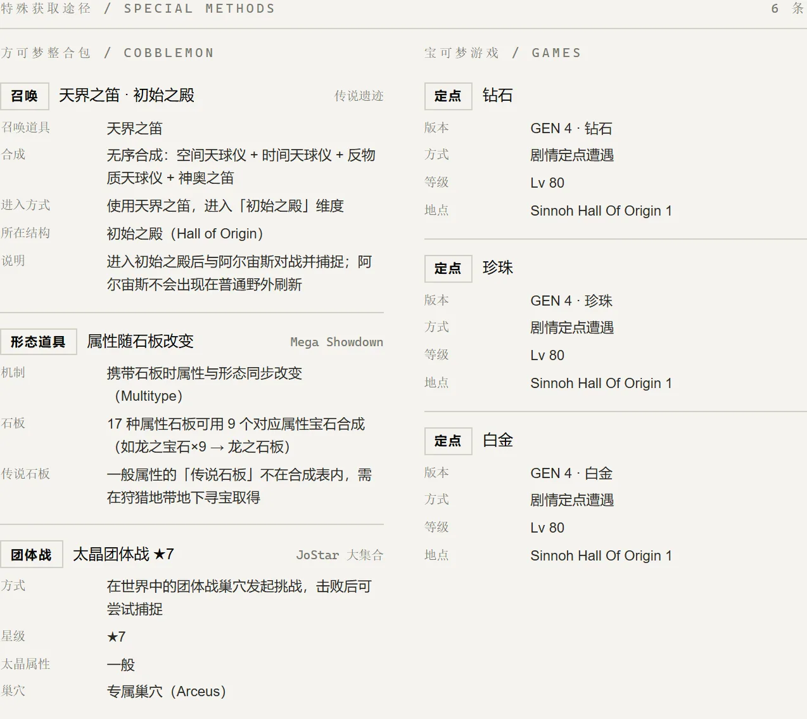
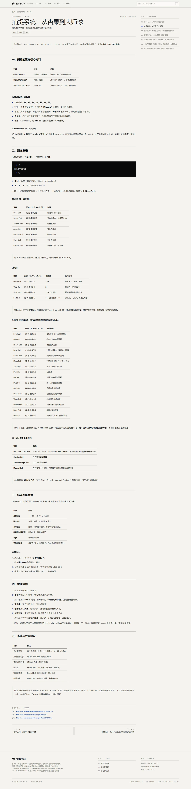
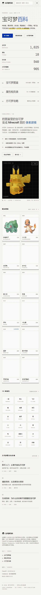

# 宝可梦百科 · PokéWiki

一个纯静态、中文优先的宝可梦图鉴网站，附带《我的世界》**方可梦（Cobblemon）**整合包攻略板块。

> **在线访问**：<https://dream-alan.github.io/Pokemon-Cobblemon_Wiki-PokeWiki-/>（GitHub Pages，纯静态托管）
> **桌面版**：见 [发布页](https://github.com/Dream-Alan/Pokemon-Cobblemon_Wiki-PokeWiki-/releases) 的绿色版压缩包，解压即用

- **1025 只宝可梦**全量图鉴（第 1–9 世代），中/英/日三语名称、种族值、属性、特性、进化链、中文图鉴描述
- **官方原画**（1025 张，512px WebP，可一键切换闪光原画）与 **方可梦像素建模**（1025 只 / 1500 个形态）双视图，模型可在浏览器里实时 3D 旋转、切换形态与闪光，每个形态播放自己的待机动画
- **获取途径**分三段呈现：方可梦的生成池条件（群系 / 时间 / 光照 / 权重 / 稀有度）、宝可梦正作的野外遭遇（按版本与方式）、建模来源（本体 / Mega Showdown / Z-A / JoStar 大集合）
- **18 个属性线性图标** + **18×18 属性相克矩阵**，双向解读（攻击方 / 防守方），支持 `/types/?focus=<属性>` 深链接
- **9 篇方可梦攻略**（入门、捕捉、生成、特殊地形、传说遗迹、繁殖进化、战斗、闪光与传说、FAQ 与踩坑），其中「特殊地形与建筑」「传说遗迹全图鉴」由脚本从整合包数据自动生成
- **对战小工具** `/tools/`：速度线对比（性格 / 努力值 / 讲究围巾 / 顺风 / 天气特性）与伤害计算（第五世代公式、16 档随机、属性相克、本系、会心、灼伤、天气、常用道具倍率），纯前端本地计算，支持 URL 分享
- **瑞士国际主义风**视觉系统：纸白底、IKB 蓝单一强调色、零圆角零阴影、12 栏网格、等宽数字
- 构建产物为 **1239 个静态页**，可丢到任意静态托管，零后端、零运行时费用

### 界面预览

| 首页 | 图鉴列表 |
| --- | --- |
|  |  |

| 详情页（原画 / 建模双视图） | 特殊形态列表 |
| --- | --- |
|  |  |

| 形态独立页（超级喷火龙 X） | 双源技能表（点开看威力 / PP / 描述） |
| --- | --- |
|  |  |

| 特殊获取途径（阿尔宙斯） | 方可梦攻略 |
| --- | --- |
|  |  |

移动端（390px，无横向溢出）：

---

## 设计语言（v1.1 改版）

| 项 | 取值 |
| --- | --- |
| 背景 / 纸面 | `#f4f3ef` / `#fbfaf7` |
| 墨色（正文） | `#0a0a09` |
| 唯一强调色 | IKB 蓝 `#002fa7`（柠檬黄 `#ffe100` 只用于记号笔与闪光按钮）；18 种属性色只作为功能色（属性图标 / 技能标签 / 属性色条） |
| 圆角 / 阴影 | 全部为 0 / none（`@theme` 里把 `--radius-*`、`--shadow-*` 归零） |
| 字体 | Inter / Helvetica Neue / PingFang SC，数字用等宽 `JetBrains Mono` |
| 标题 | `.display`：字重 200、字距 -0.04em，「越大越细」 |
| 分隔 | `.rule`（1px 墨线）与 `.rule-soft`（发丝线） |
| 装饰 | 点阵只出现在首页 hero；其余位置不添加装饰性图形 |

对应实现集中在 `src/app/globals.css` 的 `@theme` 与组件类（`.display` / `.label` / `.num` / `.chip` / `.btn` / `.card` / `.dotgrid`）。

---

## 功能概览

| 页面 | 路径 | 说明 |
| --- | --- | --- |
| 首页 | `/` | 数据概览、精选图鉴、3D 模型演示、属性入口、攻略入口 |
| 图鉴列表 | `/pokedex/` | 搜索 + 多属性 AND 筛选 + 世代筛选 + 排序 + 传说筛选，支持 URL 参数落地 |
| 宝可梦详情 | `/pokedex/<编号>/` | 原画/建模双视图（1500 个形态）、**种族值（拖动等级看 Lv1–100 能力值范围 + 取得基础点数）**、**个体能力值计算（等级 / 性格 / 个体值 / 努力值）**、**特性（点击展开效果说明）**、属性相克、图鉴描述、进化链、**特殊形态入口**、**双源可学习技能**、**方可梦获取途径**、**正作遭遇**、**特殊获取途径（限定结构 / 特殊地图 / 狩猎地带 / 道具 / 化石 / 传说遗迹召唤 / 团体战巢穴 / 野外首领战）**、建模来源、上下篇 |
| 特殊形态 | `/pokedex/<编号>/form/<形态>/` | 198 个独立条目：超级进化 / 超极巨化 / 原始回归 / 地区形态 / 其他形态（按属性或种族值区分），各自的属性、种族值、特性、**官方原画 + 3D 建模双视图**与双源技能表 |
| 属性相克 | `/types/` | 18×18 倍率矩阵 + 单属性详解（表头行首均带属性图标） |
| 攻略列表 | `/guides/` | 9 篇方可梦攻略（含按地点整理的「特殊地形与建筑」与「传说遗迹全图鉴」） |
| 攻略详情 | `/guides/<slug>/` | Markdown 渲染、表格、右侧目录、上下篇、参考来源 |
| 对战小工具 | `/tools/` | 速度线（性格 / 努力值 / 围巾 / 顺风 / 天气特性）与伤害计算（Lv50–100、16 档随机、会心 / 灼伤 / 天气 / 道具倍率），支持 `?tab=damage&a=25&b=149&move=85` 深链接 |

交互细节：`/` 全局搜索（`Ctrl + K` 会被浏览器地址栏抢占，故不用）、闪光（Shiny）贴图切换、形态切换（地区形态 / 超级进化 / 超极巨化）、拖拽旋转 3D 模型、待机动画（含眨眼与呼吸）、滚动进视口才加载模型（省电）。

---

## 技术栈

- **Next.js 16**（App Router，`output: 'export'` 全静态导出）+ **React 19** + **TypeScript**
- **Tailwind CSS v4**（`@theme` 自定义纸白 / IKB 主题，无 config 文件）
- **three.js**（自写 Bedrock 模型渲染器，见 `src/components/CobblemonViewer.tsx`）
- **react-markdown + remark-gfm**（攻略正文，GFM 表格）
- **sharp**（构建期把官方原画压成 512px WebP）
- 工具链脚本全部是零依赖 Node ESM：数据同步、素材抓取、静态预览服务器、无头浏览器截图/审计/回归测试

---

## 快速开始

需要 Node.js 20+（本项目在 Node 26 上验证）。

```bash
npm install          # 安装依赖
npm run dev          # 本地开发 http://localhost:3417
npm run build        # 静态导出到 out/（约 15 秒）
npm run typecheck    # tsc --noEmit
```

> 若在受限环境里 `npm install` 报缓存目录 EPERM，加 `--cache ./.npm-cache` 把缓存放进项目内即可。
>
> **用局域网 IP 打开 dev server 时**（如 `http://192.168.x.x:3417`），必须把该来源写进 `next.config.mjs` 的 `allowedDevOrigins`，否则 Next 16 会拦截跨源的 dev 资源，页面看起来正常但所有交互（搜索、按钮）全部失效——这是客户端组件没有 hydration 的典型症状。生产构建（`out/`）不受影响。

### npm scripts

| 脚本 | 作用 |
| --- | --- |
| `npm run dev` | 开发服务器（端口 3417） |
| `npm run build` | 静态导出到 `out/` |
| `npm run typecheck` | TypeScript 类型检查 |
| `npm run sync` | 从 PokeAPI 数据源重建 `src/data/*.json` |
| `npm run art` | 下载并压缩官方原画到 `public/art/` |
| `npm run cobblemon` | 从 Cobblemon 模组（本体 + Mega Showdown + Z-A + JoStar 大集合）抽取全部模型形态、贴图与待机动画到 `public/cobblemon/` |
| `npm run spawns` | 解析模组 `spawn_pool_world`，生成 `src/data/spawns.json`（群系 / 时间 / 光照 / 权重中文化） |
| `npm run encounters` | 从 PokeAPI 抓每只宝可梦的野外遭遇，生成 `src/data/encounters.json` |
| `npm run special` | 汇总「特殊获取途径」：递归读取所有包的 `spawn_pool_world`（含狩猎地带、JoStar 生成包）+ 化石 + 传说遗迹召唤 + 团体战巢穴（cobblemonraiddens）+ 野外首领（cobblemonboss）+ 正作赠送·定点·交换等，生成 `src/data/special.json`，并据此生成攻略 `content/guides/special-locations.md` |
| `npm run monument-guide` | 从传说遗迹模组解析 37 个世界生成结构、452 个结构 NBT（基座 / 宝箱）、15 张宝箱掉落表、59 个召唤成就、160 条合成配方，生成攻略 `content/guides/legendary-monuments.md`（每座遗迹的奖励、流程与按道具反查） |
| `npm run abilities` | 特性效果说明：Cobblemon 中文说明 + PokeAPI 中文 / 英文，生成 `src/data/ability-info.json` |
| `npm run ev-yield` | 取得基础点数（努力值），生成 `src/data/ev-yield.json` |
| `npm run moves` | 从 PokeAPI 抓招式中文名、属性、威力、PP、说明，生成 `src/data/moves.json` |
| `npm run stats` | 从 `pokedex.json` 抽紧凑种族值表 `src/data/stats.json`（对战小工具用，27KB） |
| `npm run learnsets` | 合并 Cobblemon 物种数据与正作 `pokemon_moves`，生成 `src/data/learnsets.json`（双源技能表） |
| `npm run forms` | 抽取超级进化 / 超极巨化 / 地区形态等特殊形态，生成 `src/data/forms.json` |
| `npm run form-oa` | 为 198 个特殊形态匹配并下载官方原画（PokeAPI `pokemon_forms` id → official-artwork）到 `public/form-oa/` |
| `npm run form-art` | 用无头浏览器渲染特殊形态的 3D 缩略图到 `public/form-art/`（官方原画缺失时的回退） |
| `npm run shiny-art` | 下载闪光官方原画（1025 只基础形态 + 198 个特殊形态）到 `public/art-shiny/`、`public/form-oa-shiny/`，并生成 `src/data/shiny-art.json` 清单 |
| `npm run assets` | 依次执行 sync + art + cobblemon + spawns + encounters + moves + learnsets + forms + form-oa + shiny-art |
| `npm run portable` | 用 `out/` 替换绿色版里的 `resources/site.zip`，重新产出 `release/PokeWiki-<版本>-portable.zip`（不改 Electron 外壳） |
| `npm run preview` | 用零依赖服务器预览 `out/`（端口 4199） |
| `npm run shot` | 无头浏览器截图到 `shots/` |
| `npm run audit` | 双视口检查横向溢出与破图 |
| `npm test` | 交互回归（搜索、筛选、3D、闪光、深链接、攻略渲染）+ 能力值计算回归（`test-stats`） |

---

## 目录结构

```
src/
  app/
    layout.tsx                 站点骨架、页头页脚、metadata
    page.tsx                   首页
    pokedex/page.tsx           图鉴列表（客户端筛选组件 PokedexBrowser）
    pokedex/[id]/page.tsx      详情页（1025 条全部预渲染）
    pokedex/[id]/form/[key]/page.tsx  特殊形态页（198 条：超级进化 / 超极巨化 / 地区形态 …）
    types/page.tsx             属性相克
    guides/page.tsx            攻略列表
    guides/[slug]/page.tsx     攻略详情
    not-found.tsx              404
    globals.css                Tailwind v4 主题与组件类
  components/
    CobblemonViewer.tsx        three.js Bedrock 模型渲染器（'use client'）
    PokedexBrowser.tsx         图鉴筛选/搜索/分页
    TypeMatrix.tsx             18×18 属性矩阵
    EvolutionTree.tsx          进化链（支持分支，如伊布）
    PokemonCard.tsx / FormCard.tsx / MoveList.tsx / StatBars.tsx / TypeBadge.tsx / TypeIcon.tsx / Pokeball.tsx / SiteHeader.tsx
  lib/
    types.ts                   数据模型类型定义
    data.ts                    服务端数据访问层（pokedex/chains/abilities/spawns/encounters/moves/learnsets/forms）
    shared.ts                  客户端安全的小数据（18 属性、世代、工具函数）
    moves-shared.ts            技能相关的类型与学习方式常量（客户端安全）
    guides.ts                  攻略 Markdown 加载器（自写 frontmatter 解析）
    asset.ts                   basePath 安全的静态资源路径
  data/                        pokedex.json / types.json / chains.json / index.json / cobblemon.json / spawns.json / encounters.json / special.json / moves.json / learnsets.json / forms.json ...
content/guides/*.md            攻略正文（frontmatter: title/slug/order/summary/tags/updated/sources）
public/art/                    官方原画 0001.webp … 1025.webp
public/art-shiny/              闪光官方原画（与 public/art 同名，切换闪光时读取）
public/form-oa/                特殊形态官方原画（198 张，mega / gmax / 地区形态 / 战斗形态）
public/form-oa-shiny/          特殊形态的闪光官方原画
public/form-art/               特殊形态 3D 渲染缩略图（原画缺失时的回退）
public/cobblemon/<编号>/       每只宝可梦的全部形态模型 .geo.json、贴图 .png / _shiny.png、anim_<形态>.json
scripts/                       sync-data / fetch-art / extract-cobblemon / build-spawns / fetch-encounters / build-special / build-monument-guide / sync-moves / sync-learnsets / build-forms / render-forms / serve / shot / audit / test-ui
```

**体积要点**：`src/data/pokedex.json` 有 648KB，只被服务端页面引用；客户端组件一律从 `src/lib/shared.ts`（只含 18 条属性数据）和 `src/data/index.json`（精简索引）取数，故首屏 JS 不背这份大文件。

---

## 建模渲染要点

- **贴图映射**：用模组 resolver（species + variations[].aspects/model/texture）解析每个形态的模型与贴图，不再按文件名猜——超级喷火龙 X 曾经错拿到超极巨化的贴图。
- **闪光**：同一 resolver 里 aspects 含 shiny 的变体给出闪光贴图，因此每个形态（含 Mega / 超极巨化）都能独立切换闪光。
- **动画**：每个形态用它自己的 ground_idle（超极巨化不再套基础形态的骨骼），文件只保留待机 + 眨眼，产物从 93MB 降到 39MB。
- **材质**：贴图 alpha 是二值的，用 cutout（alphaTest: 0.5）而不是混合透明，层叠的头部才不会互相透出。

### 渲染以数据为准（v1.6.0）

模型的形状、贴图、朝向、姿态一律以 `geo.json` / resolver / poser / animation 的数值为准，不为「像官方插画」加任何按物种或按观感的特例。判断标准是三条可验证的不变量：同参数可复现、几何/UV 与 Bedrock 规范逐条对应、像素/几何度量可回归（`node scripts/model-accept.mjs`）。

**坐标换算**（与 Blockbench 导入 Bedrock 的换算一致）：Bedrock 几何的 X 轴与 three.js 相反——位置 / pivot `[x,y,z] → [-x,y,z]`，旋转 `[rx,ry,rz] → [-rx,-ry,rz]`（ZYX 顺序），动画通道同理；换算后正脸朝 -Z。box-uv 六面：+X←east、-X←west、+Y←up、-Y←down、-Z←north、+Z←south，取向与 Minecraft `ModelPart.Cube` 一致；绕序统一为外侧逆时针，只渲染正面（零厚度贴片的 north/south 不再互相打架）。动画旋转按 Bedrock 语义「绑定姿态 + 通道增量」逐骨骼相加。

**已删除的美术补丁**

| 补丁 | 原做法 | 现在 |
| --- | --- | --- |
| `eyeSampler` | 扫描贴图像素猜眼睛区域，眼睛六面都贴这块 | 眼睛按普通 cube 的 box-uv 走 |
| 朝向 `rotY = π·1.22` | 转 180° 再偏 40° 取四分之三侧脸 | 单一常量：整体转 180° 正对相机（`?yaw=<度>` 仅调试偏转） |
| `xSign` / 混合欧拉 | 动画 X 取反、Z 取反，绑定旋转却不取反 | 绑定、cube、动画、poser 统一按上面的换算 |
| 骨骼链「世界朝向」换算 | 把动画旋转当整条链的绝对朝向，丢掉绑定旋转 | 局部旋转 = 绑定 + 增量 |
| 头部俯仰 `hp = -8°` | 给 `head_angle` 手工补俯仰 | 删除，头朝哪由动画决定 |
| `__headDir()` | 调试钩子 | 删除 |
| 零厚度贴片外推 0.12 + 「整块 uv 铺平」 | 把贴片往外推、改 uv | 位置与 uv 都按 geo；零面积侧面不生成 |
| `panel=mirror` 开关 | 实验性面板对调 | 删除 |
| 无动画时清零骨骼旋转 | 丢弃 geo 里的绑定旋转 | 绑定旋转保留 |
| 待机「呼吸」上下浮动 | 非数据的正弦位移 | 删除 |

保留：`eyelid*` 默认隐藏（模组 poser 睁眼时把它缩放为 0 的既有约定，`?lids=1` 显示）；`?faces=1` 六面顶点色调试；`?still=1` 不自转且时间冻结在 t=0；`?noanim=1`；新增 `?layers=0` 关闭图层。

**补齐的三项数据能力**

1. **resolver layers**：`extract-cobblemon.mjs` 把同一物种的所有 resolver 文件按 `order` 合并成变体链，对形态的 aspects 取「最后一个全部命中且带 `layers` 的变体」（闪光再加 `shiny` 求一次）。跳过 `alpha_eyes` 与 `enabled:false`。层贴图拷成 `public/cobblemon/{dex}/layer_{name}[_{帧}].png`，同名不同源用 `-2/-3` 区分；当前 **376 个形态 / 651 张层贴图 / 1.76MB**。渲染时几何只建一次，每层在原 mesh 下挂共享 geometry 的子 Mesh：emissive → `MeshBasicMaterial`（不受光、不写深度），其余 → Lambert；都带 `polygonOffset(-1,-1)`。多帧按 fps 换 `map`，只在换帧时 `needsUpdate`。层数据放在按需加载的 `render_{key}.json` 里，不进首屏 JS、不进页面 props。
2. **cube `mirror`**（含 bone 级 `mirror` 继承）：贴图沿 YZ 平面镜像——east/west 面板互换、各面水平翻转，只改 UV，不动顶点与索引。
3. **poser `transformedParts`**：只取「展示姿势」的（按 PROFILE → PORTRAIT → NONE → STAND 选第一个非水中、非战斗、非骑乘/空中条件的 pose），因为大多数 `transformedParts` 属于水面游泳等条件姿势（例如喷火龙 `body [0,22,0]` 是 surface_idle 的下沉量，套到站姿会悬空）。数值在模组 Java 模型空间（Y 向下）：position `[x,y,z] → [-x,-y,z]` 叠加到骨骼位置，rotation 叠加到绑定旋转，`isVisible` 控制显隐。当前 **34 个形态**，例如比比鸟 / 火焰鸟等只显示「收翅」那一套翅膀、帝王拿波双臂放下、超级妖火红狐身体抬回地面。
4. **待机动画取自 poser**：同一个展示姿势里 `bedrock(组, 动画)` 引用的动画才是模组实际播放的那条，抽取脚本据此挑选并在精简后的 `anim_*.json` 里写入 `pokewiki.idle`（非 Bedrock 字段）；渲染器优先用它，多条时逐骨骼叠加、各自按片段长度循环，没有标注才按名字猜 `ground_idle`。1486 份动画中 995 份取自 poser，其中 81 份与旧的按名字猜测结果不同。例如超级蒂安希的展示动画是 `air_idle`，旧逻辑选到了静态的 `idle_base`，渲染器又不认这个名字，结果 30 格长的丝带横着伸出、宝石裙摆摊平；另有霓虹鱼等水栖宝可梦改用 `water_idle`、钢铠鸦叠加收翅、密勒顿不再用骑乘待机。

## 数据来源与更新

| 数据 | 来源 | 说明 |
| --- | --- | --- |
| 图鉴数值 / 名称 / 描述 | [PokeAPI](https://pokeapi.co) 的 CSV 数据集 | 同步时做中文化映射（名称、属性、特性、进化条件、颜色） |
| 官方原画 | PokeAPI/sprites 的 `official-artwork` | sharp 转 512px WebP；缺失时回退 pokemondb，仍缺则显示占位 |
| 闪光官方原画 | PokeAPI/sprites 的 `official-artwork/shiny` | 与普通原画同名（`0001.webp`），经 jsDelivr / ghproxy 镜像下载，生成 `src/data/shiny-art.json` 清单；原画面板右上角「✦ 闪光」切换 |
| 方可梦模型与贴图 | [Cobblemon](https://modrinth.com/mod/cobblemon) Fabric 1.8.4 + `Mega Showdown` 1.2.0 + `Z-A Megas` + JoStar 大集合资源包 | 从各模组 jar 内 `bedrock/pokemon/{models,textures,animations}` 抽取，同图鉴号合并形态、本体优先 |
| 方可梦生成条件 | 模组内 `data/cobblemon/spawn_pool_world/*.json` | 2593 条生成规则 → 群系、时间、光照、结构、权重、稀有度的中文描述 |
| 特殊获取途径 | Cobblemon `spawn_pool_world`（`presets`/`condition.structures`/`spawnablePositionType`/光照·高度·天气·时间/`anticondition`）、`spawn_detail_presets`、`tags/worldgen/biome`、`fossils`、`legendarymonuments` 的 advancement·结构 NBT·语言文件、Mega Showdown 的 `recipe`（合成配方）、`species_feature_assignments`（形态特性）、`cobblemonraiddens` 巢穴、PokeAPI 遭遇方式 | 934 只有记录（方可梦 697 / 正作 780），条目类型：限定结构 699、团体战 398、首领战 237、特殊地图 172、道具 170、召唤 27、化石 17、形态道具 9、专属维度 1；正作团体战 1832、赠送 563、定点 482、地点 378 等。每条拆成 `键: 值` 事实行（位置 / 群系标签 / 光照阈值 / 高度 / 天气 / 时间 / 稀有度 / 等级区间 / 专属基座 / 所在结构 / 化石道具 / 召唤道具 / 合成配方 / 宝箱出处），措辞按数据实际语义生成（还有普通刷新时写「也会…」，唯一途径才写「仅…」），不给出无法完整展开的群系清单，化石与召唤按真实来源标注（Cobblemon / JoStar 大集合 / 传说遗迹）。传说与幻兽的合体·组装·王冠道具（基因之楔、奈克洛索尔/露奈合体器、基格尔德多面体、腐朽的剑/盾、牵绊缰绳、白金宝珠）与扭曲世界维度都据模组配方与数据逐条写入，未编造不存在的召唤仪式。另记「企业家」村民的出售清单：神奥之笛、银色羽毛、情书、火灾/冰裂/土枯/草凋四印、光明石碎片、黑暗石碎片（取自 `legendarymonuments` 的 `ModVillagersImpl#registerTrades`）；基格尔德细胞在 8.1 / 8.2 的交易表中都不存在，只写神殿宝箱出处 |
| 正作野外遭遇 | [PokeAPI](https://pokeapi.co) `/pokemon/{id}/encounters` | 846 只有记录；按版本合并等级区间与概率，并标注方式（陆地/水面/钓竿/碎岩/赠送/仅有一只等） |
| 招式数据 | [PokeAPI](https://pokeapi.co) 的 moves / move_names / move_flavor_text 等 CSV | 937 个招式：中文名、属性、分类、威力、PP、命中、优先级、中文说明 |
| 双源技能表 | Cobblemon 物种 json 的 moves + PokeAPI pokemon_moves.csv | 方可梦侧 116475 条（等级/招式机/遗传/教学/遗留），正作侧 101966 条 |
| 特殊形态 | Cobblemon 物种 json 的 forms + 模型清单 | 198 个形态 / 167 个物种（超级进化 / 超极巨化 / 原始回归 / 地区形态 / 战斗形态），纳入条件是「有模型且（特殊命名 或 属性不同 或 种族值不同）」，各自带属性、种族值、特性与专属模型 |
| 特殊形态原画 | PokeAPI `pokemon_forms.csv` 的形态 id → sprites 仓库 `official-artwork` | 198 个形态中 189 个匹配到官方原画（charizard-mega-x = 10034 等），其余 5 个（阿尔宙斯属性板、花叶蒂永恒之花、南瓜怪尺寸、银伴战兽属性记忆）无独立原画，回退基础形态图 |
| 方可梦攻略 | 官方 Wiki / 社区实测 | 正文集中在 `content/guides/*.md`，可直接改 Markdown |

更新数据：

```bash
npm run sync        # 重新生成 src/data（需能访问 PokeAPI 数据源）
npm run assets      # 重新抓原画与建模（增量：已存在且 >800 字节的会跳过）
npm run build
```

攻略是纯 Markdown，改 `content/guides/` 下文件即可，`order` 决定排序，`slug` 决定 URL。

---

## 部署

产物是纯静态站点（`out/`），任何静态托管都能跑。

### 部署到域名根路径

```bash
npm run build
# 把 out/ 整个目录上传
```

### 部署到子路径（如 GitHub Pages 的 `/<repo>/`）

```bash
NEXT_PUBLIC_BASE_PATH=/<repo> npm run build     # PowerShell: $env:NEXT_PUBLIC_BASE_PATH="/<repo>"; npm run build
```

`next.config.mjs` 会把它作为 `basePath` 注入（同时作用于 `next/link` 与 `asset()` 拼的图片路径）。GitHub Pages 还需在 `out/` 里加一个 `.nojekyll` 空文件。

本项目已部署在 GitHub Pages（`gh-pages` 分支 + 上方子路径构建）：

```bash
# 1. 用仓库名作为子路径构建（注意结尾不要加斜杠）
$env:NEXT_PUBLIC_BASE_PATH="/Pokemon-Cobblemon_Wiki-PokeWiki-"; npm run build
New-Item -ItemType File -Path out/.nojekyll -Force

# 2. 把 out/ 推到 gh-pages 分支（用临时 worktree，避免污染 main）
$tmp = ".tmp-ghpages"; New-Item -ItemType Directory $tmp | Out-Null; Push-Location $tmp
git init -q -b gh-pages; git remote add origin <repo-url>; Copy-Item ..\out\* . -Recurse -Force
New-Item -ItemType File -Name .nojekyll -Force | Out-Null
git add -A; git commit -q -m "deploy"; git push -f origin gh-pages; Pop-Location

# 3. 仓库 Settings → Pages 选择 Deploy from a branch: gh-pages / (root)
```

本地可用带前缀的静态服务器验证 Pages 行为：

```bash
node scripts/serve.mjs out 4311 /Pokemon-Cobblemon_Wiki-PokeWiki-   # 第 4 个参数是子路径前缀
```

### 常见托管

| 平台 | 步骤 |
| --- | --- |
| Cloudflare Pages | 构建命令 `npm run build`，输出目录 `out` |
| Vercel | 框架自动识别为 Next.js，无需改成 static（也可继续用 `output: 'export'`） |
| Netlify | 发布目录 `out`，构建 `npm run build` |
| Nginx / 任意静态服务 | 直接把 `out/` 当根目录；`trailingSlash: true` 已开启，目录索引可用 |

本地验证导出结果：

```bash
npm run preview     # http://localhost:4199
```

### 打包成 Windows 桌面程序

两种产物，站点数据都是同一个 `site.zip`，运行时都**不解压、不落盘**（内存里解析 zip 中央目录，按需 `inflateRawSync` 单个文件返回）：

```bash
npm run build       # 先出静态站
npm run app         # → release/PokeWiki-<版本>-windows.exe   窗口版（Electron，约 210MB）
npm run exe         # → release/PokeWiki-console.exe           控制台版（Node SEA，约 239MB）
```

**窗口版（推荐）**：Electron + electron-builder 的 `portable` 目标，单个 exe，双击直接出窗口（无黑框、无浏览器地址栏），带中文菜单（重新载入 / 缩放 / 全屏 / 关于）、窗口图标、单实例运行；站内外链会转交给系统浏览器。主进程逻辑在 `desktop/electron/main.cjs`，打包配置在 `desktop/electron/package.json` 的 `build` 字段，构建脚本 `scripts/build-app.mjs`（用 `tar` 打 `site.zip` → sharp 生成图标 → electron-builder）。

**绿色版（极少数环境需要）**：`npm run app` 同时产出 `release/PokeWiki-<版本>-portable.zip`，解压到任意文件夹后直接双击里面的 `PokeWiki.exe`。它完全不走 NSIS、也不往 `%TEMP%` 里解包 —— 如果单文件 exe 报 `NSIS Error: Error writing temporary file. Make sure your temp folder is valid.`（临时目录被安全软件/组策略锁住时会这样），用这个版本。

**控制台版（备用）**：`scripts/build-exe.mjs` 用 Node 的 [Single Executable Application](https://nodejs.org/api/single-executable-applications.html)（复制本机 `node.exe` + `postject` 注入 blob）。运行后在本机 `127.0.0.1:3417` 起服务（端口被占自动 +1 往后找，最多 30 次）、自动用默认浏览器打开首页，关掉控制台窗口即停止；启动时先 `chcp 65001`，中文不乱码。

注意：exe 都未做代码签名，首次运行可能出现 Windows SmartScreen 提示（「更多信息 → 仍要运行」）。要对外分发建议用自己的证书签名；若要安装包/自动更新，把 electron-builder 的 target 换成 `nsis` 即可。

窗口版运行时的目录约定（Chromium 对缓存目录很挑剔，路径带非 ASCII 字符或不可写时会直接报「缓存文件夹不合法」并退出）：

- `userData` / `sessionData` / `disk-cache` 全部固定在 `%LOCALAPPDATA%\PokeWiki\`（纯 ASCII），不可写时依次退到 `%APPDATA%\PokeWiki`、`%TEMP%\PokeWiki`；
- 启动日志写到 `%LOCALAPPDATA%\PokeWiki\launch.log`，记录了 site.zip 位置、条目数、监听端口、窗口是否加载完成 —— 打不开时先看这个文件；
- 站点数据仍是内存里的 `site.zip`，不会往这些目录里解压东西。

---

## 已验证项（构建自检）

- `npm run typecheck` 零错误；`npm run build` 产出 1237 页（1025 图鉴 + 198 特殊形态 + 其余）
- 桌面版（控制台版）：`release/PokeWiki-console.exe` 冷启动 0.7 秒内可访问 `/`、`/pokedex/493/`、`/pokedex/6/form/mega_x/`、`/art-shiny/0025.webp`、`/form-oa/6-mega_x.webp`（均 200），未知路径返回 404 页
- 桌面版（窗口版）：主进程的静态服务在无头环境下用替身 `electron` 模块跑通——`/`(120KB)、`/pokedex/493/`(110KB)、`/pokedex/6/form/mega_x/`(63KB) 返回 200 且 MIME 正确，原画 / 闪光原画 / 形态原画均返回 `image/webp`，未知路径回落到 404 页；窗口本体（Electron 渲染进程）需在真实桌面会话里双击验证，本机沙箱不允许其事件循环启动
- 无头浏览器回归通过：`/` 聚焦搜索、属性筛选（1025 → 69 只电系）、列表进详情、3D 画布与 WebGL、闪光切换、属性深链接、攻略正文渲染、无 JS 报错
- 技能 / 形态 / 特殊途径自检 **29 项**：详情页「特殊获取途径」区块与分类徽标、结构化字段（`dt`/`dd` 一一对应）、方可梦/正作两栏、正作定点/赠送/团体战写入、化石名称中文化（贝壳化石）、详情页「特殊形态」「可学习技能」两段存在、技能分组 tab、点技能弹出威力/PP/分类/中文描述、属性色块按属性区分、形态页种族值（超级喷火龙 X total 634）、形态卡片网格、缩略图无破图、官方原画「✦ 闪光」切换与切回、无 DOM 嵌套警告、无 JS 报错
- 1440px / 390px 双视口无横向溢出、无破图；攻略页与相克矩阵的宽表格在自己的容器里横向滚动
- 计算样式核验：全站 `border-radius: 0px`、`box-shadow: none`、强调色 `#002fa7`、标题字重 200
- 原画 **1025/1025**（#892 武道熊师、#905 眷恋云 已用形态原画 10191/10192 补齐）
- 闪光原画：原画面板右上角「✦ 闪光」按钮切换 `public/art-shiny/`（基础形态）与 `public/form-oa-shiny/`（特殊形态），切回普通原画同样即时生效；清单 `src/data/shiny-art.json` 只对已下载的条目显示按钮
- 闪光原画已覆盖 **1025/1025 只**（每个基础形态都有）与 **188/198 个特殊形态**（其余形态在 PokeAPI 里没有对应闪光原画 id，按钮自动隐藏）；像素差复核：皮卡丘 23.0%、超级喷火龙 X 42.8%、闪光暴鲤龙为红色（本体蓝色）
- 方可梦建模 **1025/1025 只、1500 个形态、2720 张贴图、1486 份待机动画**（本体 905 + Mega Showdown 的传说与 mega + Z-A + JoStar 大集合补齐本体未实装的 43 只，包括时拉比、克雷色利亚、虚吾伊德、四灾厄与悖谬种）；生成池 **1016 个物种 / 3197 条规则**
- 特殊形态 **198 个**（167 个物种），全部有官方原画或 3D 模型（超级喷火龙 X / Y、超极巨化、地区形态、原始回归、合体形态等），卡片优先展示官方原画、缺失时回退 3D 缩略图；招式库 **937 条**，双源技能表方可梦 116475 条 / 正作 101966 条
- 建模验收 `node scripts/model-accept.mjs`（v1.6.0 实测）：`still=1` 连拍像素差 #6 / #25 均 0.000%；`faces=1` 下 -Z（青）占 79.1%（+Y 10.6%、+X 4.5%、-X 3.7%、+Z 1.8%、-Y 0.3%）；alpha_eyes 层 0 个；5 个随机 mirror 模型 +X/-X 面板平均色均不相等；#6 超极巨化 / 普通高度比 1.35；图层开/关像素差 #6 正面 0.14%（相对模型像素 0.53%）、#6 侧面 0.98%（4.41%）、#493 0.53%（1.88%）——尾焰 / 辉光面积小，按「整张画布 >2%」的标准判为未达标；`public/cobblemon` 实际字节 45.2MB

---

## 版权声明

本项目的**代码**可自由使用。宝可梦相关的名称、图像、数据、模型版权归 **任天堂 / Creatures Inc. / GAME FREAK inc. / The Pokémon Company** 所有；方可梦（Cobblemon）模型与贴图版权归 Cobblemon 团队及其贡献者。本项目为非官方的爱好者作品，仅供学习与个人使用，不得用于商业用途。